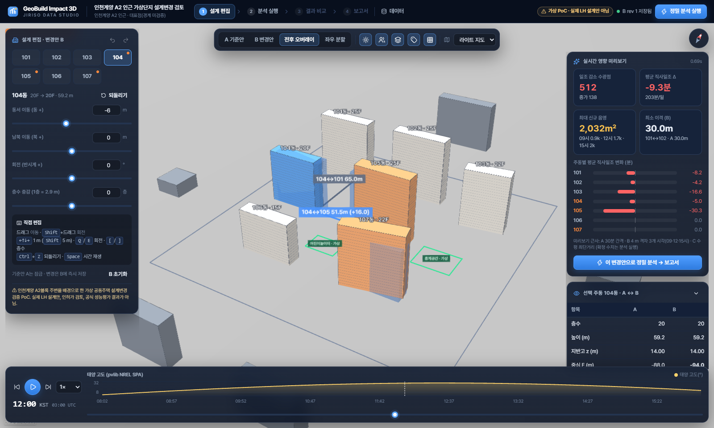
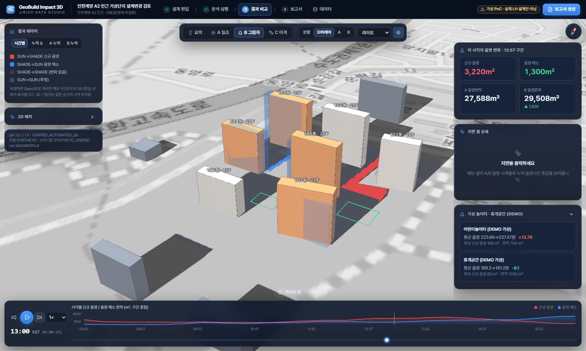
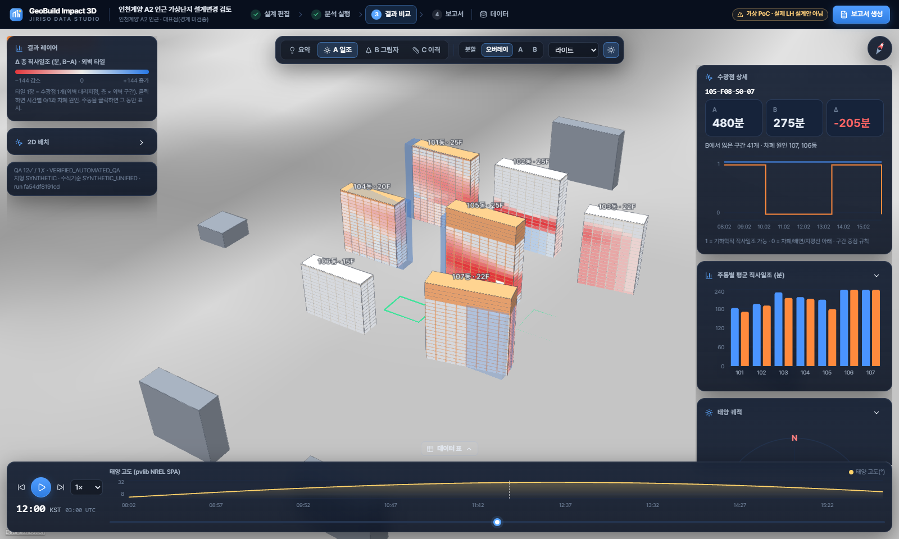
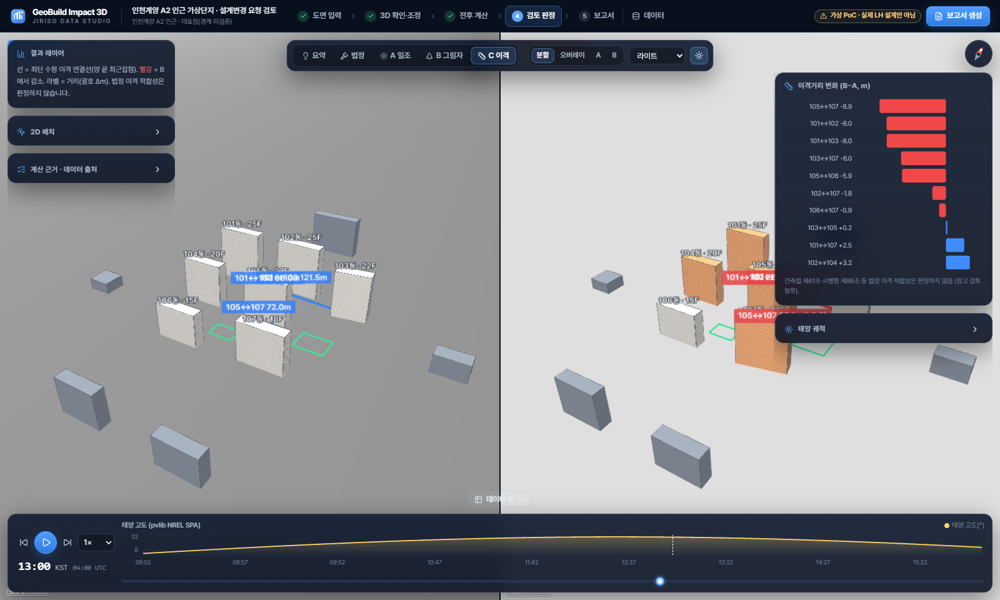

# GeoBuild Impact 3D

**JIRISO DATA STUDIO** · LH 공동주택 설계변경 검토 지원 도구

**이 도구가 답하는 질문: "설계사가 요청한 설계변경을 승인해도 되는가?"**
LH 검토 담당자가 기존 승인안(A)과 변경 요청안(B)의 배치도를 올리면, 같은 조건(동지 08–16시)으로 계산해 다음을 판정하고 검토 의견서로 남깁니다.

| 검토 항목 | 무엇을 보나 | 근거 |
|---|---|---|
| 법정 이격·일조 사선 | 정북방향 일조, 채광창→인접대지경계, 동간 이격(가~마목) 미달 여부. 변경으로 새로 생긴 미달과 기존 미달 구분 | 건축법 61조, 시행령 86조, 인천광역시 건축 조례 32조 (원문: [docs/law/LAW_TEXTS.md](docs/law/LAW_TEXTS.md)) |
| 세대별 일조 (동·호) | 변경 후 동지 일조 기준에 새로 미달하는 세대 목록 (예: 105동 205호) | 09–15시 연속 2시간 또는 08–16시 총 4시간 |
| 주변 기존 건물 | 인접 단지·주택의 일조가 새로 기준 미달이 되는 곳 | GIS건물통합정보(SHP) 업로드 |
| 놀이터 그늘·동간거리 변화 | 변화 폭이 큰 곳 확인 | 검토 우선순위 참고선 |

결과는 **보완 요청 / 확인 필요 / 특이사항 없음** 판정과 항목별 근거로 표시되고, 검토자가 승인·조건부 승인·보완 요청·반려 의견을 기록하면 PDF 첫 장 「설계변경 검토 의견서」에 들어갑니다.

### 작업 순서
1. **도면 입력** — 기존안·변경안 배치도를 DXF(레이어 선택 → 동 외곽·대지경계·동번호·층수 자동 추출) 또는 PDF/이미지(외곽선 따라 그리기)로 입력. 측량 좌표(EPSG:5186 등)는 자동 배치, 아니면 기준점 2개로 맞춤. 주변 건물은 GIS건물통합정보 SHP(zip)로 교체
2. **3D 확인** — 전후 배치를 3D로 확인 (예시 단지는 슬라이더로 변경안 작성 가능)
3. **전후 계산** — 일조·그림자·이격·세대별 일조·주변 건물 일조 (Open3D 광선교차, 데모 단지 약 10초)
4. **검토 판정** — 판정 카드, 법정 검토(3D 측정선, 기준일·용도지역·조례·도로 폭·벽면 유형 설정), 세대별 일조표, 주변 피해 목록, 검토자 의견 기록
5. **보고서** — 검토 의견서 + 상세 기술보고서 PDF, 증거 ZIP

### 판정의 한계 (검토자가 알고 있어야 할 것)
- 법정 항목은 입력 형상(평지붕, 균일 층고 2.9 m)으로 계산한 **1차 검토**입니다. 옥탑·계단실 높이 제외, 대지 높이차(영 119조), 발코니 등 돌출부, 지구단위계획의 별도 기준은 반영하지 않습니다(계수는 직접 지정 가능). 가목은 마주보는 두 동 중 높은 동 높이로 계산합니다(보수적 해석).
- 정북방향 기준은 적용 기준일에 따라 바뀝니다: 2027.2.11.까지 10 m 이하 1.5 m / 초과 높이의 1/2, 2027.2.12.부터 10 m·17 m 3단계(법 61조① 개정).
- 세대별 일조는 각 동의 주개구부 벽면을 층당 세대수로 균등 분할한 창 중심(층 바닥 + 1.5 m) 기준이며 모서리 세대의 측면 창은 보지 않습니다. 실제 세대 평면이 있으면 층당 세대수를 입력하세요.
- 주변 건물 피해는 외벽 약 6 m 간격 지점 기준이며(세대 위치 미상), 수목·옹벽 등은 반영하지 않습니다.

> ⚠ **기본으로 불러오는 예시 단지는 인천계양 A2블록 주변을 배경으로 한 가상 단지이며 실제 LH 설계안이 아닙니다.** 실제 검토는 도면·주변 건물·DEM을 올려서 합니다. 자동 판정은 인허가 판단을 대신하지 않습니다.
> 기본 지형은 **합성(SYNTHETIC) 30 m DEM**이며 실제 인천계양 지형이 아닙니다. 실제 30 m DEM GeoTIFF는 [데이터] 탭에서 업로드할 수 있습니다.

## 라이브 데모 (Railway)

**https://app-production-4fadbb17.up.railway.app**

| 예시 | 결과 비교 화면 | 기술보고서 |
|---|---|---|
| DEMO · 합성 30 m DEM | [/projects/f899e2de5dfd/compare/9887c3fa81a0](https://app-production-4fadbb17.up.railway.app/projects/f899e2de5dfd/compare/9887c3fa81a0) | [/reports/9887c3fa81a0](https://app-production-4fadbb17.up.railway.app/reports/9887c3fa81a0) |
| SRTM 30 m DEM (계양산 포함 ±4.8 km) | [/projects/b8f984491b32/compare/6f71cdf84ebb](https://app-production-4fadbb17.up.railway.app/projects/b8f984491b32/compare/6f71cdf84ebb) | [/reports/6f71cdf84ebb](https://app-production-4fadbb17.up.railway.app/reports/6f71cdf84ebb) |

API 문서: [/docs](https://app-production-4fadbb17.up.railway.app/docs) · 상태: [/api/health](https://app-production-4fadbb17.up.railway.app/api/health)

배포 구성: 단일 Railway 서비스(루트 `Dockerfile`: React/Cesium 빌드 + FastAPI + RQ worker + Chromium) + 영구 볼륨 `/data`(SQLite·결과·보고서) + Railway Redis(사설망 `redis.railway.internal`, 큐 `geobuild-analysis-prod`). `main` 브랜치 push 시 자동 재배포. 로그인 없는 공개 PoC이므로 업로드는 300 MB로 제한됩니다.

## 화면 (v0.2 UX)

| 설계 편집 | 결과 비교 – B 그림자 타임랩스 |
|---|---|
|  |  |
| **A 일조 – 외벽 타일** | **C 이격 – 좌우 분할** |
|  |  |

- **3D 직접 편집**: 주동 드래그 = 이동, `Shift`+드래그 = 회전, `←↑↓→`(Shift ×5) · `Q/E` 회전 · `[ ]` 층수, `Ctrl+Z / Ctrl+Shift+Z` 되돌리기/다시하기. 편집 중 최근접 이격선이 실시간으로 갱신됩니다.
- **실시간 영향 미리보기**: 놓는 즉시 서버가 같은 엔진으로 근사 계산(A 30분 · B 4 m 3시각 · C)한 일조 감소 수·평균 일조 Δ·신규 음영·최소 이격과 주동별 변화를 보여줍니다(확정 수치는 정밀 분석).
- **분석 지형 위 배경지도**: 분석 지면 높이장을 Cesium 지형으로 사용하고 그 위에 OSM 지도(라이트·다크·컬러)를 입힙니다. 층 구분선·외곽선·동 라벨.
- **타임라인 재생**: 08–16시 재생 시 3D 그림자(시각용)와 Open3D로 계산된 해당 구간의 신규 음영/음영 해소 격자가 함께 움직이고, 아래 차트가 면적 곡선을 따라갑니다. 태양 궤적도(동지·춘추분·하지 참조).
- **결과 요약**: 계산 결과에서 결정론적으로 생성한 핵심 결과·검토 권고 카드(보고서와 같은 생성기).

## 무엇을 하는가

| 단계 | 내용 |
|---|---|
| 편집 | 기준안 A(잠금) / 변경안 B — 주동별 동서·남북 이동(m), 회전(°), 층수(1층=2.9 m) 슬라이더. 저장 시 시나리오 해시·revision 갱신 |
| 계산 | 서버 작업(Redis+RQ, Railway Redis)에서 A/B/C 계산. 입력은 불변 스냅샷, cache key = 입력 해시+시나리오+시간/격자/알고리즘 |
| A 직사일조 | pvlib NREL SPA 태양위치 + Open3D `RaycastingScene` 3D 광선교차. 외벽 대리지점(facade_proxy) 수광점별 총/최대연속 직사일조, A/B 동일 ID 비교, 차폐 원인 건물 |
| B 그림자 | 2 m 지표 격자(공통 분모) × 5분 간격 광선교차. 신규 음영/음영 해소 면적-시간 곡선, 누적 음영시간 증감, 대표시각 4상태, 가상 놀이터·휴게공간 |
| C 이격 | ENU 평면 Shapely 최단거리·최근접점, 접촉/중첩 0 m 플래그, 외벽 법선 방향 거리, 가상 대지경계 이격 |
| 검토 | Cesium 3D (A/B/오버레이/좌우 분할 카메라 동기화), 시간 슬라이더(KST→UTC 동일 순간), 수광점/격자 클릭 드릴다운, 최단 연결선, 표 CSV |
| 보고서 | 결과 JSON에서 결정론적으로 생성한 16장(+표지) 상세 HTML/PDF(A4, 목차 쪽번호, 그림·표 번호), 증거 ZIP(CSV/GeoJSON/JSON/SVG/PNG/manifest) |

## 빠른 시작 (로컬, Windows/macOS/Linux)

필요: Python 3.12 + [uv](https://docs.astral.sh/uv/), Node 20+ (검증: Node 24.19), (선택) Railway Redis.

```bash
# 1) backend
cd backend
uv sync                                  # uv.lock 고정 버전 설치
uv run playwright install chromium       # PDF 렌더러
cp .env.example .env                     # REDIS_URL 입력 (비우면 JOB_BACKEND=thread 로컬 모드)
uv run python -m scripts.migrate         # DB 스키마 생성 (SQLite 기본, DATABASE_URL로 PostgreSQL)
uv run python -m scripts.seed_demo       # (선택) DEMO 프로젝트 생성
uv run uvicorn app.main:app --port 8000  # API  → http://127.0.0.1:8000/docs (OpenAPI)
uv run python -m app.worker              # RQ worker (다른 터미널, REDIS_URL 필요)

# 2) frontend
cd ../frontend
npm ci
npm run dev                              # → http://127.0.0.1:5173/projects
```

Windows에서는 `scripts/dev.ps1`이 API·worker·frontend를 한 번에 띄웁니다.

### 대용량 실제 DEM 가져오기 (예: 전국 SRTM 30 m 모자이크)

수 GB 파일은 브라우저 업로드 대신 원본을 그대로 두고 대상지 주변만 잘라 등록합니다(재표본화 없음, 원본 경로·크기·SHA-256 기록).

```bash
cd backend
uv run python -m scripts.import_dem --path "C:/.../srtm_dem_30.tif"              # 새 프로젝트(가상 단지) + DEM 활성화
uv run python -m scripts.import_dem --path "..." --project <project_id>          # 기존 프로젝트에 등록
```

전체 ±4.8 km를 덮는 실제 DEM은 지형 모델을 ±4.8 km / 20 m 메쉬로 넓혀(계양산 등 원거리 산지 차폐 반영) 분석합니다. 합성 DEMO는 ±1.2 km / 10 m를 유지합니다.
수직기준 메타데이터가 없는 파일은 `UNRESOLVED`로 표시되며 지오이드/타원체 상수 환산을 하지 않습니다.
로그인은 없습니다(로컬 PoC).

### Docker (미검증 — 이 개발 환경에 Docker 없음)

```bash
docker compose up --build                                       # frontend:5173, api:8000, worker, postgres(PostGIS)
REDIS_URL=redis://redis:6379/0 docker compose --profile local-redis up --build   # Redis까지 로컬
```

API 이미지에서 `fonts-noto-cjk`와 `playwright install --with-deps chromium`를 설치합니다. 이 저장소의 개발 PC에서는 Docker를 사용할 수 없어 compose 실행을 **검증하지 못했습니다**(docs/QA_RESULTS.md BLOCKED 항목).

## Redis (Railway)

작업큐는 Railway에 프로비저닝한 Redis(프로젝트 `geobuild-impact-3d`, 서비스 `Redis`, 공개 TCP 프록시)를 사용합니다. 접속 URL은 `backend/.env`의 `REDIS_URL`에만 있고 git에서 제외됩니다. Windows에서는 fork가 없어 `SimpleWorker`+`TimerDeathPenalty`, Linux에서는 일반 RQ `Worker`를 사용합니다. Redis가 끊기거나 활성 worker가 없으면 API 프로세스 내 스레드로 대체 실행하며, 실제 사용된 백엔드가 실행 기록과 UI에 표시됩니다.

## 테스트

```bash
cd backend && uv run pytest -v              # 66개: 해석해·독립 태양위치·전체 장면 엔진 교차검증·A==B·좌표·DEM 실패경로·API E2E·PDF 검증·리뷰 회귀
cd frontend && npx playwright test          # 실제 브라우저 E2E (API·worker·dev 서버 실행 상태에서)
```

결과 기록: [docs/QA_RESULTS.md](docs/QA_RESULTS.md). 설계: [docs/ARCHITECTURE.md](docs/ARCHITECTURE.md). 단계 계획: [docs/IMPLEMENTATION_PLAN.md](docs/IMPLEMENTATION_PLAN.md).

## 데이터와 출처

| 자료 | 분류 | 출처 |
|---|---|---|
| 대상지 대표점 37.5559943N, 126.7545222E (동양동 413-2) | REAL_OFFICIAL (점만) | [LH 청약플러스 인천계양 A2 공고](https://apply.lh.or.kr/lhapply/apply/wt/wrtanc/selectWrtancInfo.do?aisTpCd=05&ccrCnntSysDsCd=02&mi=1027&panId=0000060706&uppAisTpCd=05) 지도 마커, 2026-11-18 접근. 블록 경계 미검증 |
| 교차확인 (동양동 법정동 중심점) | REAL_OFFICIAL | OpenStreetMap Nominatim, ODbL |
| 기본 분석일 2026-12-22 (동지) | REAL_OFFICIAL | [한국천문연구원 2026 월력요항](https://astro.kasi.re.kr/kor/life/post/calendarData?search_year=2026) |
| 30 m DEM | **SYNTHETIC** (DEMO) / USER_UPLOADED | 자체 생성 GeoTIFF(EPSG:5179, 실제 지형 아님) / 사용자 제공 `srtm_dem_30.tif`(EPSG:5179, 25.9 m 셀, 수직기준 미기재 → UNRESOLVED, SRTM 표면모델 성격) |
| 주동 7개·주변건물 5개·대지경계·놀이터·휴게공간 | SYNTHETIC | 자체 생성 가상 형상 |
| 계획지반 | DERIVED | 대상지 내 DEM 중앙값 평탄 pad + 60 m 접합대 (가상 지반 가정) |
| 배경지도 (선택) | — | © OpenStreetMap contributors (타일 실패 시에도 3D·분석 정상) |

Cesium ion 토큰, Esri, 비공개 LH BIM은 사용하지 않습니다. Cesium 정적 자산은 자체 호스팅(`/cesium`)합니다.

## 한계 (요약)

기하학적 직사일조 가능 시간(일사량·실내조도·기상 아님) · 외벽 대리지점(세대별 일조 아님) · 30 m DEM 정확도 · 분석영역(2.4 km) 밖 차폐 미반영 · 법정 일조/이격 적합성 판정 없음(건축법 제61조·시행령 제86조는 참고만).
